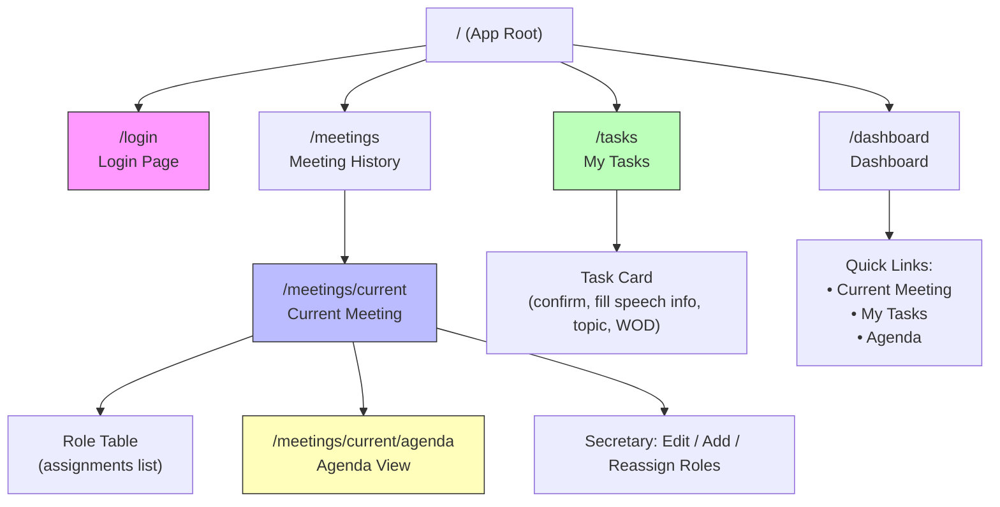
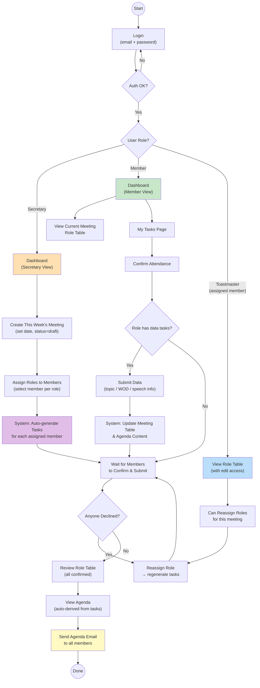
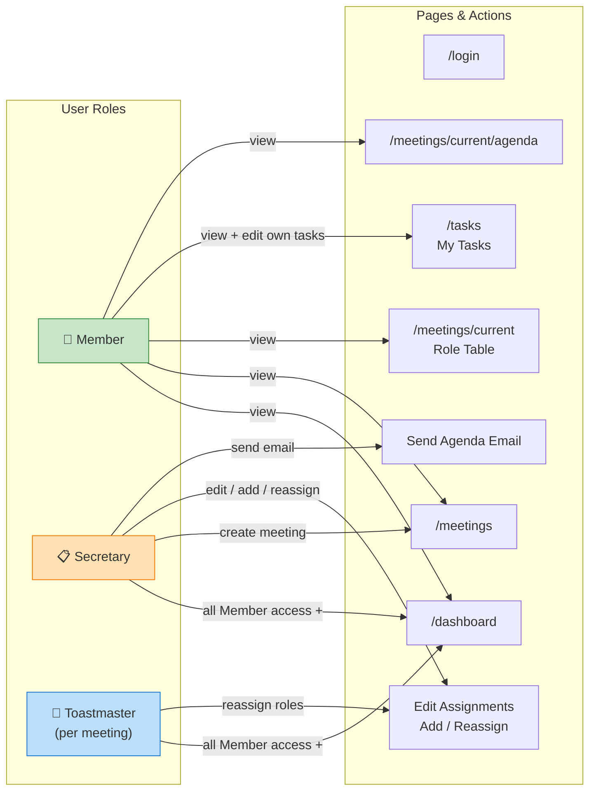
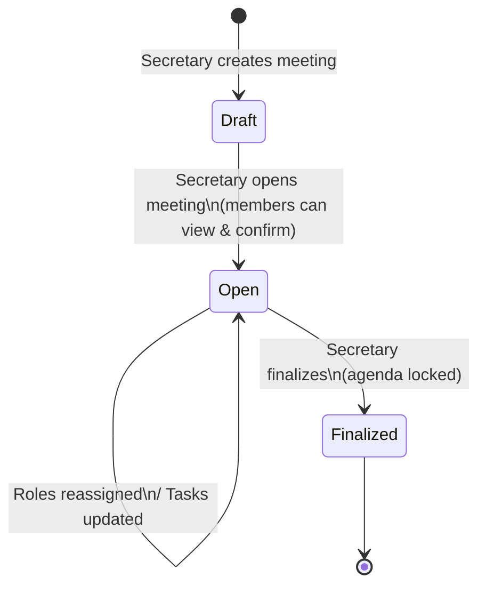

# Information Architecture & Page Flow

This document describes every page in the Toastmasters Club Management Website, what each page contains, who can access it, and how pages connect to each other.

---

## Site Map



---

## Core User Flow



---

## Role × Page Permission Matrix



---

## Page-by-Page Specification

### 1. `/login` — Login Page

| Attribute | Detail |
|-----------|--------|
| **Access** | Public (unauthenticated) |
| **Purpose** | Authenticate users with email + password |
| **UI Elements** | Email input, password input, login button, error message area |
| **Behavior** | On success → redirect to `/dashboard`. On failure → show error inline. |
| **API** | `POST /api/auth/login` |
| **Rendering** | Client Component (form interaction) |

---

### 2. `/dashboard` — Dashboard

| Attribute | Detail |
|-----------|--------|
| **Access** | All authenticated users |
| **Purpose** | Landing page after login; quick navigation hub |
| **UI Elements — All Users** | Welcome message with user name, quick-link cards to Current Meeting / My Tasks / Agenda |
| **UI Elements — Secretary Only** | "Create Meeting" button (shown when no current draft/open meeting exists), summary of confirmation progress (e.g., "4/8 confirmed") |
| **Behavior** | Secretary sees meeting management actions. Members see task status summary. |
| **API** | `GET /api/auth/session`, `GET /api/meetings/current` |
| **Rendering** | Server Component shell + Client Component for interactive cards |

---

### 3. `/meetings` — Meeting History

| Attribute | Detail |
|-----------|--------|
| **Access** | All authenticated users |
| **Purpose** | List past and current meetings |
| **UI Elements** | Table or card list: meeting date, status badge (draft / open / finalized), link to detail. Secretary sees "Create New Meeting" button at top. |
| **Behavior** | Click a meeting → navigate to its detail page. Current meeting is highlighted. |
| **API** | `GET /api/meetings` |
| **Rendering** | Server Component (static list) |

---

### 4. `/meetings/current` — Current Meeting (Role Table)

This is the most important page in the app.

| Attribute | Detail |
|-----------|--------|
| **Access** | All authenticated users can view. Secretary and current Toastmaster can edit. |
| **Purpose** | Show the weekly role assignment table; manage assignments |
| **UI Elements** | |

**Role Table columns:**

| Column | Content |
|--------|---------|
| Role Name | e.g., Toastmaster, Prepared Speaker #1, Language Evaluator |
| Assignee | Member name |
| Confirmation | Pending / Confirmed / Declined badge |
| Data Status | Shows whether required task data has been submitted (e.g., topic provided, speech title filled) |
| Actions | Reassign button (secretary / TM only) |

**Additional UI:**
- "Add Role" button (secretary only) — opens a form to pick role type and assign a member
- Meeting date and status header
- "View Agenda" link
- "Open Meeting" / "Finalize Meeting" status-transition buttons (secretary only)

| Attribute | Detail |
|-----------|--------|
| **API** | `GET /api/meetings/current`, `GET /api/meetings/:id/assignments`, `PATCH /api/meetings/:id/assignments/:assignmentId`, `POST /api/meetings/:id/assignments` |
| **Rendering** | Client Component (React Query for live data, mutations for edits) |

**Reassign Flow (inline on this page):**
1. Secretary or Toastmaster clicks "Reassign" on a role row.
2. A dropdown or modal shows available members.
3. On confirm → API updates assignment owner, resets confirmation, regenerates tasks for new assignee.
4. Table refreshes via React Query invalidation.

---

### 5. `/tasks` — My Tasks

| Attribute | Detail |
|-----------|--------|
| **Access** | All authenticated users (each sees only their own tasks) |
| **Purpose** | Personal task list generated from role assignments |
| **UI Elements** | Task cards grouped by meeting, each card shows: |

**Task Card structure:**

| Field | Example |
|-------|---------|
| Task Title | "Confirm Attendance" / "Provide Meeting Topic" / "Provide Speech Title" |
| Status | Pending / Completed badge |
| Input | Toggle for confirmation; text input for topic, WOD; text fields for project name + speech title |
| Save button | Saves the answer and marks task complete |

| Attribute | Detail |
|-----------|--------|
| **Behavior** | Saving a task immediately updates the meeting's role table data status and agenda-relevant content. |
| **API** | `GET /api/tasks/me`, `PATCH /api/tasks/:id` |
| **Rendering** | Client Component (React Query: `useMyTasksQuery`, `useUpdateTaskMutation`) |

**Task types by role:**

| Role | Tasks Generated |
|------|----------------|
| Toastmaster | Confirm attendance, Provide meeting topic |
| Language Evaluator | Confirm attendance, Provide word of the day |
| Prepared Speaker | Confirm attendance, Provide project name, Provide speech title |
| General Evaluator | Confirm attendance |
| Individual Evaluator | Confirm attendance |
| Table Topic Master | Confirm attendance |
| Joke Master | Confirm attendance |
| Timer | Confirm attendance |

---

### 6. `/meetings/current/agenda` — Agenda View

| Attribute | Detail |
|-----------|--------|
| **Access** | All authenticated users can view. Secretary can send. |
| **Purpose** | Display the auto-generated meeting agenda derived from completed tasks |
| **UI Elements** | |

**Agenda sections:**

| Section | Source |
|---------|--------|
| Meeting Date | `meetings.meetingDate` |
| Meeting Topic | Toastmaster's "provide meeting topic" task answer |
| Word of the Day | Language Evaluator's "provide word of the day" task answer |
| Role Assignments | Full role table with assignee names |
| Prepared Speeches | Each speaker's project name + speech title from their tasks |
| Status Notes | Any unconfirmed or incomplete items highlighted |

**Secretary-only actions:**
- "Send Agenda Email" button → `POST /api/meetings/:id/agenda/send`
- Confirmation dialog before sending

| Attribute | Detail |
|-----------|--------|
| **Behavior** | Content is read-only and fully derived from task data. No direct editing. |
| **API** | `GET /api/meetings/:id/agenda` |
| **Rendering** | Server Component for layout + Client Component for send button |

---

## Navigation Structure

```
┌─────────────────────────────────────────────┐
│  Header / Nav Bar                           │
│  ┌──────┐ ┌──────────┐ ┌──────┐ ┌───────┐  │
│  │ Home │ │ Meetings │ │Tasks │ │Logout │  │
│  └──────┘ └──────────┘ └──────┘ └───────┘  │
└─────────────────────────────────────────────┘

- Home       → /dashboard
- Meetings   → /meetings  (current meeting highlighted)
- Tasks      → /tasks
- Logout     → POST /api/auth/logout → /login
```

All pages except `/login` share a common layout with the nav bar. The nav bar highlights the active section. Mobile-responsive: collapses into a hamburger menu on small screens.

---

## State Transition: Meeting Lifecycle



- **Draft**: Secretary is setting up roles. Members cannot see the meeting yet.
- **Open**: Members can view the role table, confirm attendance, and submit task data.
- **Finalized**: Meeting preparation is complete. Agenda is locked. Email can be sent.

---

## Data Flow Summary

```
Secretary creates meeting
        │
        ▼
Secretary assigns roles
        │
        ▼
System generates tasks ──────────────────┐
        │                                │
        ▼                                ▼
Members see tasks          Role table shows
on /tasks page             "pending" status
        │                                │
        ▼                                ▼
Members complete tasks     Confirmation status
(confirm, fill data)       updates in table
        │                                │
        ▼                                ▼
Task answers sync ───────► Agenda content
to meeting data            auto-populates
                                         │
                                         ▼
                           Secretary sends
                           agenda email
```

---

## File Structure (Next.js App Router)

> **Note:** Authenticated pages use the `(app)` route group which includes a shared `NavBar` layout.
> The `/ → /dashboard` redirect lives at `app/page.tsx`. Login is outside the group.

```
app/
├── layout.tsx              # Root layout (fonts, QueryProvider)
├── page.tsx                # Redirect / → /dashboard
├── login/
│   └── page.tsx            # Login page (Client Component)
├── (app)/
│   ├── layout.tsx          # Authenticated layout (NavBar, session check)
│   ├── dashboard/
│   │   └── page.tsx        # Dashboard
│   ├── meetings/
│   │   └── current/
│   │       ├── page.tsx    # Current meeting role table
│   │       └── agenda/
│   │           └── page.tsx # Agenda view
│   └── tasks/
│       └── page.tsx        # My tasks
└── api/
    ├── auth/
    │   ├── login/route.ts
    │   ├── logout/route.ts
    │   └── session/route.ts
    ├── meetings/
    │   ├── route.ts                         # GET list, POST create
    │   ├── current/route.ts                 # GET current meeting
    │   └── [id]/
    │       ├── route.ts                     # GET single meeting
    │       ├── assignments/
    │       │   ├── route.ts                 # GET list, POST create
    │       │   └── [assignmentId]/route.ts  # PATCH update
    │       └── agenda/
    │           ├── route.ts                 # GET agenda
    │           └── send/route.ts            # POST send email
    └── tasks/
        ├── me/route.ts                      # GET my tasks
        └── [id]/route.ts                    # PATCH update task
```

---

## Implementation Status

| Component | Status | Notes |
|-----------|--------|-------|
| Data Models (User, Meeting, Assignment, Task) | ✅ Done | Mongoose schemas + TS types |
| Auth (login, logout, session, JWT, middleware) | ✅ Done | `jose` JWT, httpOnly cookie |
| Seed Script | ✅ Done | 8 demo users, `npm run seed` |
| Role Templates | ✅ Done | 8 role types with task definitions |
| Login Page | ✅ Done | Client Component, form → POST /api/auth/login → /dashboard |
| Dashboard | ✅ Done | Session-aware, quick-link cards, Create Meeting form (secretary) |
| NavBar + App Layout | ✅ Done | `(app)` route group with server-side session check |
| GET /api/meetings | ✅ Done | List all meetings |
| GET /api/meetings/current | ✅ Done | Returns latest draft/open meeting |
| GET /api/meetings/[id] | ✅ Done | Returns single meeting |
| POST /api/meetings (create) | ✅ Done | Secretary-only, creates draft meeting |
| PATCH /api/meetings/[id] | ✅ Done | Status transitions: draft→open→finalized |
| GET /api/meetings/[id]/assignments | ✅ Done | Returns assignments with assignee + tasks |
| POST /api/meetings/[id]/assignments | ✅ Done | Add role + auto-generate tasks from template |
| GET /api/members | ✅ Done | List active members (for assignment dropdowns) |
| Current Meeting page (role table) | ✅ Done | Role table + Add Role form + status buttons + inline Reassign dropdown |
| React Query hooks | ✅ Done | `useSession`, `useCurrentMeeting`, `useMeetingAssignments`, `useMembers`, `useCreateMeeting`, `useAddAssignment`, `useUpdateMeetingStatus`, `useMyTasks`, `useUpdateTask`, `useReassignAssignment`, `useAgenda`, `useSendAgenda` |
| GET /api/tasks/me | ✅ Done | Returns user's tasks with meeting/assignment context |
| PATCH /api/tasks/[id] | ✅ Done | Update task answer + status; syncs confirm→assignment, topic→meeting |
| Tasks page | ✅ Done | Task cards grouped by meeting; confirm/decline + text input per type |
| PATCH /api/meetings/[id]/assignments/[assignmentId] | ✅ Done | Reassign role: update assignee, reset confirmation, delete old tasks, regenerate new tasks |
| GET /api/meetings/[id]/agenda | ✅ Done | Derives agenda from assignments + tasks (topic, WOD, roles, speeches, warnings) |
| POST /api/meetings/[id]/agenda/send | ✅ Done | Sends agenda email to all active members via Resend |
| Agenda page | ✅ Done | Agenda card with topic, WOD, role table, prepared speeches, warnings, send button (secretary) |
| UI Polish | ✅ Done | NavBar active-state fix, View Agenda link on meeting page, user display name, dashboard cleanup |
